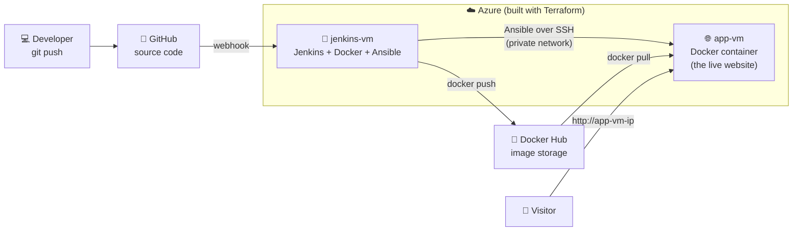

# 🚀 End-to-End CI/CD Pipeline on Azure

**Jenkins · Docker · Ansible · Terraform · GitHub · Azure (free tier)**

> **In one line:** When I `git push` code, it is **automatically tested, packaged and deployed** to a live server on Azure, with no manual steps.

---

## 📖 Table of Contents

1. [What does this project do?](#-what-does-this-project-do)
2. [Architecture (the big picture)](#-architecture-the-big-picture)
3. [Tools used, explained simply](#-tools-used-explained-simply)
4. [Project folder structure](#-project-folder-structure)
5. [How the pipeline works, step by step](#-how-the-pipeline-works-step-by-step)
6. [How I built it (the journey)](#-how-i-built-it-the-journey)
7. [Run the app on your laptop](#-run-the-app-on-your-laptop)
8. [Rebuild the whole project from scratch](#-rebuild-the-whole-project-from-scratch)
9. [Keeping it free 💰](#-keeping-it-free-)
10. [Problems I faced and how I fixed them](#-problems-i-faced-and-how-i-fixed-them)
11. [Security practices used](#-security-practices-used)
12. [What I learned](#-what-i-learned)
13. [Next steps](#-next-steps)

---

## 🎯 What does this project do?

Imagine a small website. Normally, to update it you would:

1. Change the code
2. Test it by hand
3. Package it
4. Log in to the server
5. Copy the new version and restart it

That's slow, boring, and easy to get wrong. 😓

**This project automates all of that.** I only do step 1. The pipeline does the rest:

```
I change code ─► git push ─► ✅ tested ─► 📦 packaged ─► 🌐 live on the internet
                              (all automatic, about 2-3 minutes)
```

If a test fails, **the pipeline stops** and the broken code **never reaches the live server**. 🛡️

---

## 🏗️ Architecture (the big picture)



**In plain words:**

| # | What happens | Who does it |
|---|---|---|
| 1 | I push code to GitHub | Me 💻 |
| 2 | GitHub tells Jenkins "new code arrived!" | GitHub **webhook** |
| 3 | Jenkins builds the app into a **Docker image** | Jenkins + Docker |
| 4 | Jenkins runs the **tests inside that image** | pytest |
| 5 | Jenkins uploads the image to **Docker Hub** | Docker |
| 6 | Jenkins tells **Ansible** to deploy the new image to app-vm | Ansible |
| 7 | Ansible checks the app is healthy (`/health`) | Ansible |
| 8 | Visitors see the new version 🎉 | app-vm |

Both servers (and their network and firewall) were created **with code** using **Terraform**.

---

## 🧰 Tools used, explained simply

| Tool | Simple explanation | Role in this project |
|---|---|---|
| **Git & GitHub** | A time machine and online backup for code | Stores the code and triggers the pipeline |
| **Python + Flask** | A language and a small web framework | The website itself (`app.py`) |
| **pytest** | Automatic code checker | Tests that the website works |
| **Docker** | Puts an app and everything it needs into one box (an "image") that runs the same everywhere | Packages the app |
| **Docker Hub** | An online store for Docker images | Stores every version of the app |
| **Jenkins** | A robot that runs a list of steps for you | Runs the CI/CD pipeline |
| **Ansible** | A remote control for servers. You write *what* you want in YAML | Deploys the app to app-vm |
| **Terraform** | Builds cloud infrastructure from code | Creates the network, firewall and VMs on Azure |
| **Azure** | Microsoft's cloud: rented computers on the internet | Hosts both servers |

### 🤔 CI vs CD?

- **CI (Continuous Integration):** every change is automatically **built and tested**.
- **CD (Continuous Deployment):** every change that passes is automatically **put live**.

This project does **both**.

### 🤔 Terraform vs Ansible?

| Terraform 🏗️ | Ansible 🛋️ |
|---|---|
| **Builds the house** (servers, network, firewall) | **Furnishes the house** (installs software, deploys the app) |
| "Create 2 VMs on Azure" | "Install Docker and run my container" |

---

## 📁 Project folder structure

```
ci-cd-final-pipeline/
│
├── app.py                ← 🌐 The Flask web app (home page + /health)
├── requirements.txt      ← 📦 Python libraries the app needs
├── pytest.ini            ← ⚙️  Test settings
├── tests/
│   └── test_app.py       ← 🧪 Automatic tests
│
├── Dockerfile            ← 🐳 Recipe to build the Docker image
├── .dockerignore         ← 🚫 Files Docker should skip
│
├── Jenkinsfile           ← 🔧 The CI/CD pipeline (Pipeline as Code)
│
├── ansible/
│   ├── inventory.ini     ← 📋 WHICH servers to deploy to
│   └── deploy.yml        ← 📜 WHAT to do on them (the playbook)
│
├── terraform/
│   ├── providers.tf      ← ☁️  Use Azure
│   ├── variables.tf      ← 🔤 Settings (region, names, SSH key)
│   ├── main.tf           ← 📦 Resource group + list of VMs
│   ├── network.tf        ← 🌐 Network, public IPs, firewall rules
│   ├── compute.tf        ← 🖥️  The 2 VMs + nightly auto-shutdown
│   └── outputs.tf        ← 📤 Prints IPs and SSH commands
│
├── .gitignore            ← 🙈 Keeps secrets and junk out of Git
└── README.md             ← 📖 You are here
```

---

## 🔄 How the pipeline works, step by step

The pipeline is defined in the [`Jenkinsfile`](Jenkinsfile). It has **5 stages**:

```
┌──────────┐   ┌─────────────┐   ┌──────────┐   ┌──────────────┐   ┌──────────┐
│ Checkout │ → │ Build Image │ → │   Test   │ → │  Push Image  │ → │  Deploy  │
└──────────┘   └─────────────┘   └──────────┘   └──────────────┘   └──────────┘
  get code      docker build      pytest in       to Docker Hub      Ansible →
  from GitHub                     container                          app-vm
                                  ❌ fail = STOP
```

| Stage | What it does | Command |
|---|---|---|
| **1. Checkout** | Downloads the latest code from GitHub | `checkout scm` |
| **2. Build Image** | Builds a Docker image tagged with the build number (e.g. `:7`) | `docker build -t sree6303/cicd-flask-app:7 .` |
| **3. Test** | Runs the tests **inside** the new image | `docker run --rm <image> python -m pytest` |
| **4. Push Image** | Logs in with a **secret token** and uploads the image | `docker push` |
| **5. Deploy** | Runs the Ansible playbook against app-vm | `ansible-playbook ... -e image_tag=7` |

**After every build** (pass or fail), Jenkins logs out of Docker Hub and cleans up old images.

### What the Ansible playbook does on app-vm

[`ansible/deploy.yml`](ansible/deploy.yml):

1. ✅ Make sure Docker is installed
2. ✅ Make sure Docker is running
3. 🔄 Pull the new image and **replace** the old container
4. 🩺 Call `/health` until it answers `200 OK` (up to 10 tries)
5. 🧹 Delete old images to save disk

> 💡 **Idempotent:** if something is already correct, Ansible skips it. Running it twice is safe.

### How you can *see* each deployment

The build number is passed into the app as `APP_VERSION`, so the home page shows:

```
Hello from the CI/CD Pipeline!
Version: 7                          ← Jenkins build number
Served by: 9b5352ce907e             ← Docker container ID
Deployed automatically by Jenkins 🤖
```

---

## 🛤️ How I built it (the journey)

| Phase | What I did | Result |
|---|---|---|
| **1. Accounts** | Created free GitHub, Docker Hub and Azure accounts. Set an Azure **budget alert** | Safety net against surprise bills |
| **2. App + Git** | Wrote a Flask app with a `/health` endpoint and 2 pytest tests | Code on GitHub ✅ |
| **3. Docker** | Wrote a `Dockerfile` (slim image, non-root user, healthcheck, Gunicorn) | Image on Docker Hub ✅ |
| **4. Terraform** | Wrote Terraform for the resource group, VNet, subnet, NSGs, public IPs and 2 Ubuntu VMs with auto-shutdown | `terraform apply` builds everything ✅ |
| **5. Jenkins** | Installed Java, Jenkins, Docker and Ansible on jenkins-vm. Added 2 GB swap. Saved the Docker Hub token in Jenkins Credentials | Jenkins ready ✅ |
| **6. CI** | Wrote the `Jenkinsfile`: checkout → build → test → push | Build #1 green ✅ |
| **7. CD** | Gave Jenkins its own SSH key to reach app-vm. Wrote the Ansible inventory and playbook. Added a Deploy stage | App live on the internet ✅ |
| **8. Automation** | Added a GitHub **webhook**, so every `git push` starts the pipeline | Fully automatic 🎉 |

---

## 💻 Run the app on your laptop

### Option A: with Python
```bash
python -m venv venv
# Windows:  .\venv\Scripts\Activate.ps1
# Mac/Linux: source venv/bin/activate
pip install -r requirements.txt
python app.py
```
Open http://localhost:5000

Run the tests:
```bash
python -m pytest -v
```

### Option B: with Docker
```bash
docker build -t cicd-flask-app .
docker run -d -p 5000:5000 -e APP_VERSION=local --name flask-test cicd-flask-app
```
Open http://localhost:5000. Stop it with `docker rm -f flask-test`.

---

## 🧱 Rebuild the whole project from scratch

<details>
<summary><b>Click to expand the full setup guide</b></summary>

### Prerequisites
- Free accounts: **GitHub**, **Docker Hub** (plus an access token), **Azure**
- On your laptop: **Git**, **Docker Desktop**, **Azure CLI**, **Terraform**

### 1. Create the infrastructure (Terraform)
```bash
# Create an SSH key (press Enter for an empty passphrase)
ssh-keygen -t rsa -b 4096 -f ~/.ssh/cicd-key -C "cicd-project"

az login
cd terraform
echo 'subscription_id = "<YOUR-SUBSCRIPTION-ID>"' > terraform.tfvars

terraform init
terraform plan
terraform apply          # type: yes
terraform output         # shows public/private IPs and SSH commands
```

### 2. Set up jenkins-vm
```bash
ssh -i ~/.ssh/cicd-key azureuser@<JENKINS-PUBLIC-IP>

# Swap memory (the VM only has 1 GB RAM)
sudo fallocate -l 2G /swapfile && sudo chmod 600 /swapfile
sudo mkswap /swapfile && sudo swapon /swapfile
echo '/swapfile none swap sw 0 0' | sudo tee -a /etc/fstab

# Java + Jenkins (check jenkins.io for the current repo key)
sudo apt update && sudo apt install -y fontconfig openjdk-21-jre
sudo mkdir -p /etc/apt/keyrings
sudo wget -O /etc/apt/keyrings/jenkins-keyring.asc https://pkg.jenkins.io/debian-stable/jenkins.io-2026.key
echo "deb [signed-by=/etc/apt/keyrings/jenkins-keyring.asc] https://pkg.jenkins.io/debian-stable binary/" \
  | sudo tee /etc/apt/sources.list.d/jenkins.list
sudo apt update && sudo apt install -y jenkins

# Docker + Ansible
sudo apt install -y docker.io docker-buildx ansible
sudo usermod -aG docker jenkins
sudo systemctl restart jenkins

# SSH key so Jenkins can reach app-vm
sudo -u jenkins mkdir -p /var/lib/jenkins/.ssh
sudo -u jenkins ssh-keygen -t ed25519 -f /var/lib/jenkins/.ssh/id_ed25519 -N ""
sudo cat /var/lib/jenkins/.ssh/id_ed25519.pub     # copy this line
```

### 3. Allow Jenkins into app-vm
```bash
ssh -i ~/.ssh/cicd-key azureuser@<APP-PUBLIC-IP>
echo "<PASTE-JENKINS-PUBLIC-KEY>" >> ~/.ssh/authorized_keys
exit

# Back on jenkins-vm, test it:
sudo -u jenkins ssh azureuser@<APP-PRIVATE-IP> hostname            # type: yes
sudo -u jenkins ansible all -i "<APP-PRIVATE-IP>," -u azureuser -m ping   # → pong
```
Then update `ansible/inventory.ini` with the app-vm **private** IP.

### 4. Configure Jenkins (browser: `http://<JENKINS-PUBLIC-IP>:8080`)
1. Unlock with `sudo cat /var/lib/jenkins/secrets/initialAdminPassword`, then install the suggested plugins
2. **Manage Jenkins → Credentials → Global → Add**:
   *Username with password*, username = Docker Hub user, password = Docker Hub token, **ID = `dockerhub-creds`**
3. **New Item → Pipeline** → *Pipeline script from SCM* → Git → repo URL → branch `*/main` → Script Path `Jenkinsfile`
4. **Triggers:** ☑️ *GitHub hook trigger for GITScm polling*

### 5. Add the GitHub webhook
Repo → **Settings → Webhooks → Add webhook**
- Payload URL: `http://<JENKINS-PUBLIC-IP>:8080/github-webhook/` (keep the trailing `/`)
- Content type: `application/json`
- Event: **Just the push event**

Now every `git push` deploys automatically. 🎉

</details>

---

## 💰 Keeping it free

| Practice | Why |
|---|---|
| Used **free-tier VM sizes** (`Standard_B2ats_v2`) | 750 free hours/month for 12 months |
| Used **64 GB Premium SSD (P6)** disks | Included in the free tier |
| **Auto-shutdown at 11 PM IST** on both VMs (in Terraform) | No forgotten VMs running all night |
| Azure **budget alert** (`zero-budget`) | Email if spending ever starts |
| Stop VMs when not practicing | Saves free hours |

```bash
# Stop (no compute charges)
az vm deallocate -g rg-cicd-project -n jenkins-vm --no-wait
az vm deallocate -g rg-cicd-project -n app-vm --no-wait

# Start again
az vm start -g rg-cicd-project -n jenkins-vm --no-wait
az vm start -g rg-cicd-project -n app-vm --no-wait

# Delete EVERYTHING when the project is finished
cd terraform && terraform destroy
```

---

## 🐞 Problems I faced and how I fixed them

Real problems from building this project, and good interview talking points.

| Problem | Cause | Fix |
|---|---|---|
| `terraform plan` seemed stuck, then errored on "Resource Providers" | A brand-new Azure subscription registers providers the first time (2–5 min) | Waited and ran it again. It's a one-time thing |
| `SkuNotAvailable` for `Standard_B1s` in Central India | Azure ran out of capacity for that size, in every zone | Switched app-vm to `Standard_B2ats_v2` (also free tier). Terraform only recreated the missing VM, thanks to its **state file** |
| Jenkins slow or crashing on a 1 GB VM | Not enough RAM | Added **2 GB swap** |
| `permission denied` on `docker.sock` in Jenkins | The `jenkins` user wasn't allowed to use Docker | `usermod -aG docker jenkins` + restart Jenkins |
| A `sed` command failed while editing `authorized_keys` | SSH keys contain `/`, which `sed` uses as its separator | Used `grep` to filter and `echo >>` to append instead |
| `PytestCacheWarning: Permission denied` | The container runs as a **non-root** user (on purpose) | Ran pytest with `-p no:cacheprovider` |
| The `Deploy` stage didn't work | It was accidentally **nested inside** the `Push Image` stage | Fixed the braces so all stages are siblings |
| A push didn't trigger a build | The Jenkins job had been accidentally **disabled** | Re-enabled it and used **Redeliver** on the webhook in GitHub |

---

## 🔒 Security practices used

- 🔑 **SSH keys only.** Password login is disabled on both VMs.
- 🔐 **Docker Hub token** stored in **Jenkins Credentials**, never in code. It's masked as `****` in logs.
- 👤 Jenkins has its **own SSH key** to reach app-vm, so my personal key never goes on the server.
- 🏠 Jenkins → app-vm traffic uses the **private network** (`10.0.1.x`).
- 🧱 **Firewall (NSG)** opens only the needed ports: 22 + 8080 on jenkins-vm, 22 + 80 on app-vm.
- 🐳 The container runs as a **non-root user**.
- 🙈 `.gitignore` keeps `terraform.tfstate`, `*.tfvars`, `venv/` and `.env` out of GitHub.

**Possible improvements:** a webhook secret, HTTPS, restricting SSH and 8080 to known IPs, and image vulnerability scanning (Trivy).

---

## 🎓 What I learned

- **Git:** clone, commit, push, `.gitignore`, webhooks
- **Python:** Flask web app, health checks, unit tests with pytest
- **Docker:** writing a Dockerfile, image tags, running tests in containers, Docker Hub
- **Terraform:** providers, variables, `locals`, `for_each`, `dynamic` blocks, state, plan/apply
- **Azure:** resource groups, VNets, subnets, NSGs, public vs private IPs, VM sizes, budgets
- **Linux:** SSH and keys, swap, `systemctl`, `apt`, users and groups
- **Jenkins:** installation, credentials, Pipeline as Code, stages, `post` actions, triggers
- **Ansible:** inventory, playbooks, modules, idempotency, smoke tests
- **DevOps mindset:** automate everything, fail fast, keep secrets out of code, infrastructure as code

---

## 🔭 Next steps

- [ ] ☸️ Deploy to **Kubernetes** (Docker Desktop, then AKS)
- [ ] 🔒 Add a **Trivy** security scan stage and a webhook secret
- [ ] 🔁 Add a **rollback** option (deploy any previous build number)
- [ ] 📊 Add **monitoring** with Prometheus + Grafana
- [ ] 🔐 Serve the app over **HTTPS**

---

👤 **Author:** Sai Sree T · GitHub [@sreepradat](https://github.com/sreepradat)

⭐ If this project helped you understand CI/CD, give it a star!
